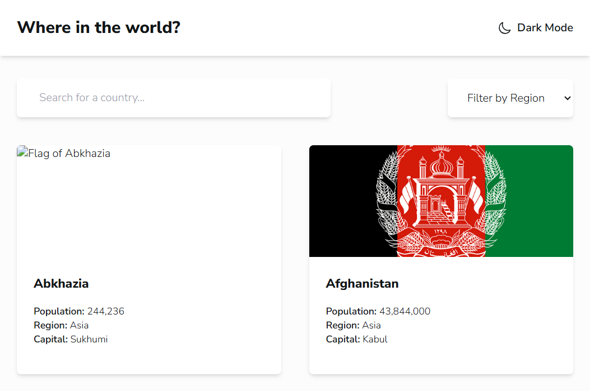
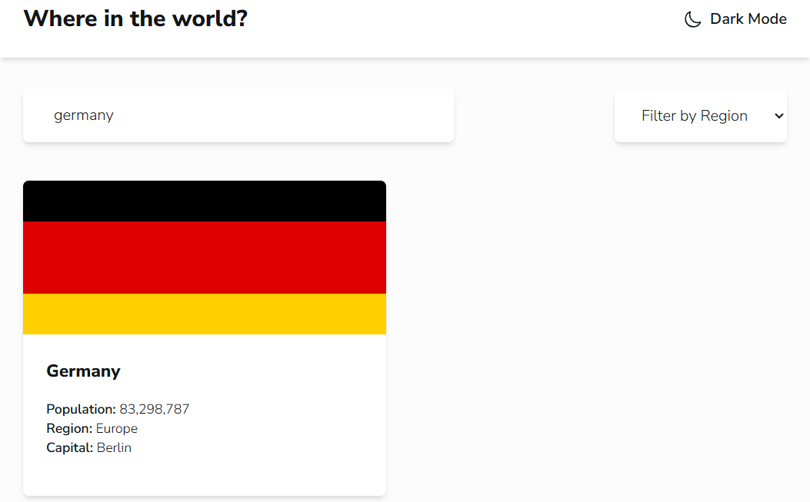
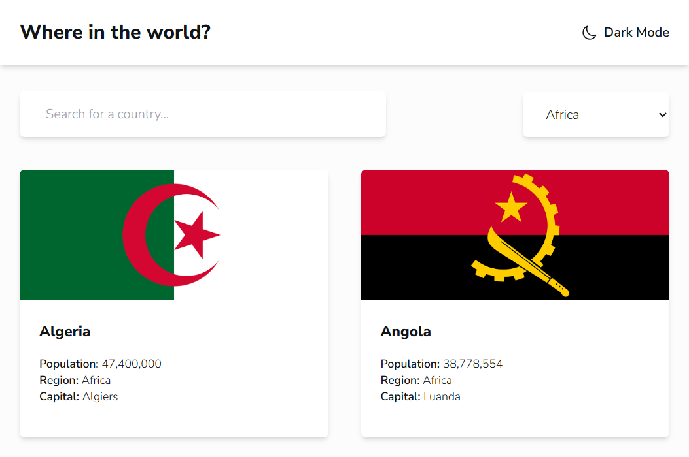
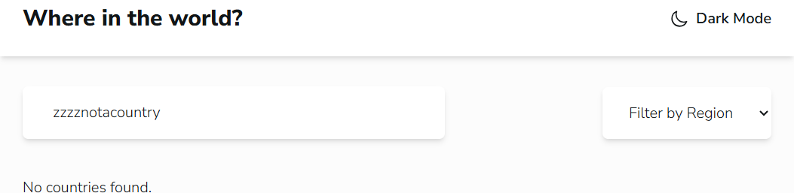
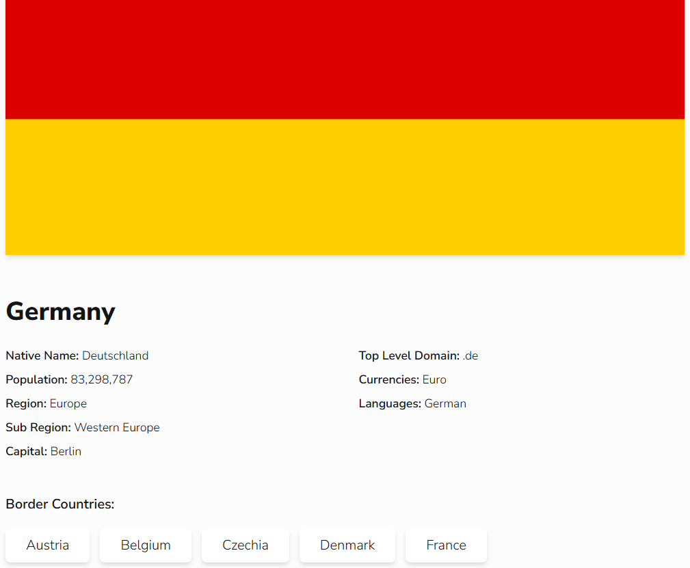
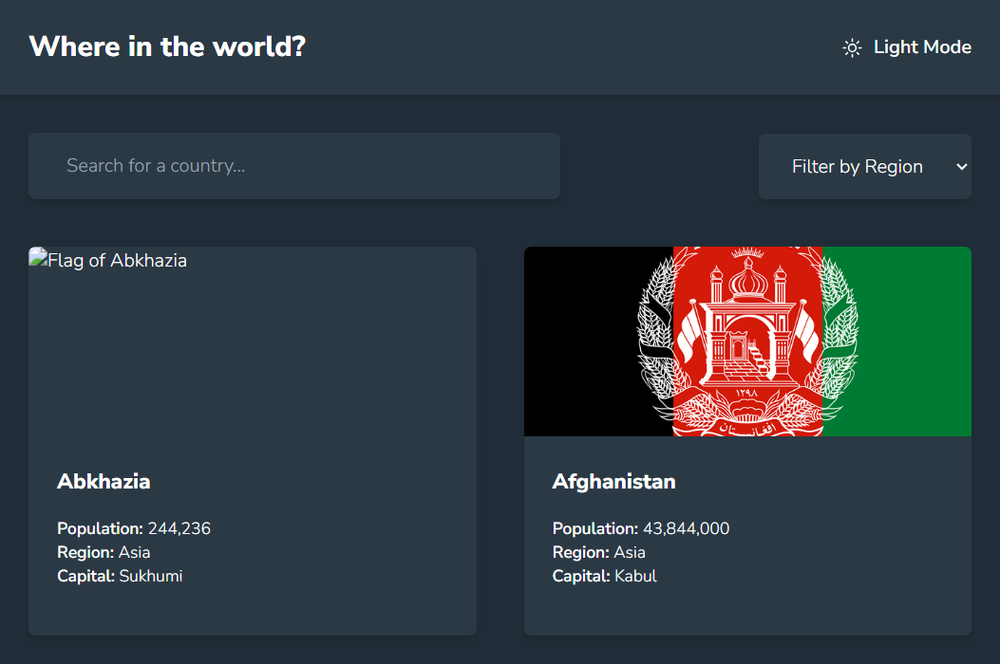

# REST Countries

A React page that lists countries from REST Countries v5. The dev server is Vite 8.3.0 at http://localhost:5173/. The page title is Rest Countries API. The typeface is Nunito Sans.

From this folder:

```
npm install
npm run dev
```

Put the key in `.env.local` as `VITE_REST_COUNTRIES_API_KEY`. Restart the dev server after changing that file. The key is sent as a Bearer token. The browser calls `/api/countries`, and Vite proxies that path to `https://api.restcountries.com/countries/v5`. The request asks for 100 countries and the fields used by the cards and the detail view.

While the list is loading, the page says "Loading countries...". A failed request says "Could not load the API."

## The list

The heading is "Where in the world?". Each card shows the flag, the common name, the population with commas, the region, and the capital. A missing capital is shown as N/A.

This run returned 100 countries, from Abkhazia through Hong Kong:

| Region | Count |
| --- | --- |
| Africa | 25 |
| Americas | 32 |
| Asia | 12 |
| Europe | 19 |
| Oceania | 8 |
| Antarctic | 4 |

The page background is `rgb(252, 252, 252)` and the text is `rgb(17, 21, 23)`. Cards and the header are white. At this window, about 842px wide, the cards are in two columns. The layout is one column, two columns from 640px, and four columns from 1024px.



Abkhazia's flag did not load. The image address was `https://flagcdn.com/w320/.png`, and the card shows the alt text "Flag of Abkhazia". The other 99 flags loaded. Antarctica has population 1,300, region Antarctic, and capital N/A. Bouvet Island and Heard Island and McDonald Islands have population 0 and capital N/A.

## Search and region

The search box placeholder is "Search for a country...". The match ignores letter case and keeps a country when its name contains the text. `germany` left one card: Germany, population 83,298,787, region Europe, capital Berlin.



The region menu is Filter by Region, Africa, Americas, Asia, Europe, and Oceania. Antarctic is a region on four cards, and it is not one of those options, so those four stay on the unfiltered list. Africa left 25 countries. The first two were Algeria, population 47,400,000, capital Algiers, and Angola, population 38,778,554, capital Luanda.



A search that matches nothing says "No countries found."



## A country

Clicking a card opens that country. The header stays. Back returns to the list and keeps the search text.

Germany's detail view uses the larger flag. Native Name is Deutschland, population 83,298,787, region Europe, sub region Western Europe, capital Berlin, top level domain `.de`, currency Euro, and language German. Border buttons are the neighbors that are also in the loaded 100: Austria, Belgium, Czechia, Denmark, and France.



France opened from its button. Native Name is France, population 69,081,996, sub region Western Europe, capital Paris, top level domain `.fr`, currency Euro, language French, and the border buttons were Andorra, Belgium, and Germany.

## Dark mode

The page starts in light mode. The header button says Dark Mode. After the click it says Light Mode, the page background is `rgb(32, 44, 55)`, the text is white, and the header and cards are `rgb(43, 57, 69)`.


